# Production-Ready RAG System

A retrieval-augmented generation (RAG) system for question answering over your own documents. The example data is nutrition PDFs, but you can load any documents and change the system prompt for your topic.

It is a Python monorepo with a streaming chat API, a document ingestion pipeline, and a full Docker deployment with monitoring.

## Contents

- [Features](#features)
- [Architecture](#architecture)
- [Repository layout](#repository-layout)
- [How it works](#how-it-works)
- [Tech stack](#tech-stack)
- [Setup from zero to first answer](#setup-from-zero-to-first-answer)
- [Configuration](#configuration)
- [Model configuration (LiteLLM)](#model-configuration-litellm)
- [Langfuse setup](#langfuse-setup)
- [Ingesting documents (MinIO + Prefect)](#ingesting-documents-minio--prefect)
- [API](#api)
- [Local development](#local-development)
- [Testing and code quality](#testing-and-code-quality)
- [Evaluation, load testing, CI, monitoring](#evaluation-load-testing-ci-monitoring)
- [Troubleshooting](#troubleshooting)
- [Monorepo design](#monorepo-design)

## Features

- **Streaming chat API** built with FastAPI and Server-Sent Events (SSE)
- **Semantic cache** on Redis, so repeated or similar questions are answered instantly
- **Vector search** on Qdrant, with a minimum-score filter that drops weak matches
- **Input guardrails** that mask emails, phone numbers, API keys, secrets and card numbers before anything reaches the model
- **LLM tracing, prompt management and cost tracking** with Langfuse
- **LLM gateway** through LiteLLM, so providers (Cohere, OpenAI, Groq) can be swapped from config
- **Ingestion pipeline** orchestrated with Prefect, reading source files from MinIO
- **Evaluation** with RAGAS, with runs stored in Langfuse
- **Monitoring** with Prometheus and Grafana

## Architecture

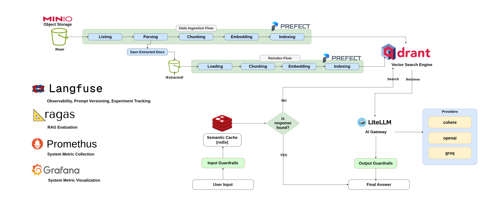

- **Chat path:** input guardrails, semantic cache, vector search, LiteLLM, output guardrails, final answer.
- **Ingestion:** two Prefect flows (data ingestion and reindex) fill Qdrant from files stored in MinIO. Put your files in MinIO and they are versioned there.
- **Tools around the system:** Langfuse (tracing, prompt versions, experiments), RAGAS (RAG evaluation), Prometheus and Grafana (system metrics).

## Repository layout

This is a [uv workspace](https://docs.astral.sh/uv/concepts/projects/workspaces/) with three packages, plus folders for evaluation, load tests and Docker.

```
.
├── api/                              # FastAPI app: /chat and /health
│   ├── api/
│   │   ├── routes/
│   │   │   ├── chat.py               # POST /chat (SSE stream)
│   │   │   ├── health.py             # GET /health
│   │   │   └── schemas/chat.py       # request schemas
│   │   ├── services/
│   │   │   ├── rag_service.py        # embed, retrieve, generate
│   │   │   ├── caching_service.py    # Redis semantic cache
│   │   │   └── guardrails_service.py # masks sensitive input
│   │   ├── helpers/
│   │   │   ├── config.py             # API settings (env variables)
│   │   │   ├── prompts.py            # context construction
│   │   │   └── utils.py
│   │   ├── metrics.py                # Prometheus metrics
│   │   └── main.py                   # app + lifespan wiring
│   ├── tests/                        # routes/, services/, helpers/
│   └── pyproject.toml
├── data_pipeline/                    # Prefect flows
│   ├── data_pipeline/
│   │   ├── parse/                    # extract text from source files
│   │   │   ├── extractors.py
│   │   │   └── tasks.py
│   │   ├── vectorize/                # chunk, embed, write to Qdrant
│   │   │   ├── chunkers.py
│   │   │   ├── tasks.py
│   │   │   └── reindex_flow.py       # reindex flow
│   │   ├── helpers/                  # config, utils
│   │   ├── data_ingestion_pipeline.py# data ingestion flow
│   │   └── deploy.py                 # registers both flows as Prefect deployments
│   ├── tests/                        # tests
│   └── pyproject.toml
├── shared/                           # code used by both packages
│   ├── shared/
│   │   ├── llm/                      # LLM and embedding clients
│   │   ├── prompts/                  # Langfuse prompt manager
│   │   ├── vectordb/                 # vector DB interface + Qdrant provider
│   │   └── config.py
│   ├── tests/                        # llm/, vectordb/
│   └── pyproject.toml
├── docker/                           # full deployment (see docker/README.md)
│   ├── docker-compose.yml
│   ├── api/Dockerfile
│   ├── data_pipeline/Dockerfile
│   ├── env/                          # .env.example.* templates
│   ├── litellm_proxy/config.yml      # LiteLLM model list
│   ├── nginx/default.conf
│   ├── prometheus/prometheus.yml
│   └── README.md
├── evals/                            # RAGAS evaluation (see evals/README.md)
│   ├── dataset.jsonl
│   └── run_eval.py
├── loadtests/                        # Locust load test (see loadtests/README.md)
│   └── locustfile.py
├── docs/imgs/                        # architecture diagram and screenshots
├── .github/workflows/                # GitHub Actions CI
├── .pre-commit-config.yaml
├── pyproject.toml                    # workspace root
├── uv.lock
└── README.md
```

Each folder with its own README has the details for that part:

| Folder | Guide |
|---|---|
| `docker/` | [docker/README.md](docker/README.md): services, ports, Grafana, commands |
| `evals/` | [evals/README.md](evals/README.md): how to score the RAG pipeline |
| `loadtests/` | [loadtests/README.md](loadtests/README.md): how to load test the API |

## How it works

### Answering a question

1. The question is masked by the guardrails, then embedded.
2. The semantic cache is checked. On a hit, the stored answer is returned.
3. On a miss, Qdrant returns the top-K chunks, and weak matches are dropped.
4. The prompt is compiled from the retrieved context and the model streams the answer back.
5. The finished answer is written to the cache.

If no chunk passes the score filter, the API replies that the content does not contain enough information. It does not call the model.

### Ingesting documents

Two Prefect flows keep Qdrant up to date.

| Flow (Prefect deployment) | Steps | Reads from | Writes to |
|---|---|---|---|
| **Data ingestion** (`rag-data-ingestion`) | List → Parse → Chunk → Embed → Index | `raw/` in MinIO | Qdrant, the extracted text in `extracted/`, and moves the source file to `processed/` |
| **Reindex** (`reindex-pipeline`) | Load → Chunk → Embed → Index | `extracted/` in MinIO | Qdrant |

Parsing is the slow step, so its output is saved to `extracted/`. When you change the chunking or the embedding model, run the reindex flow and the raw files are not parsed again.

## Tech stack

| Area | Tools |
|---|---|
| Language | Python 3.13 |
| API | FastAPI, Uvicorn |
| Vector DB | Qdrant |
| Cache | Redis Stack (RedisVL) |
| LLM gateway | LiteLLM |
| LLM observability and experiments | Langfuse |
| RAG evaluation | RAGAS |
| Load testing | Locust |
| Orchestration | Prefect |
| Object storage | MinIO |
| Monitoring | Prometheus, Grafana |
| Packaging | uv workspaces |
| Quality | pytest, Ruff, pre-commit |
| CI | GitHub Actions |
| Deployment | Docker Compose, nginx |

## Setup from zero to first answer

Follow these steps in order. Each step links to the section with the details.

| # | Step | Where |
|---|---|---|
| 1 | Get API keys: Cohere (and/or Groq), and a Langfuse account | provider dashboards |
| 2 | Create the env files and fill them in | [Configuration](#configuration) |
| 3 | Create the Langfuse project, API keys and prompt | [Langfuse setup](#langfuse-setup) |
| 4 | Start the stack: `docker compose up -d --build` | below |
| 5 | Create the MinIO bucket and upload your documents | [Ingesting documents](#ingesting-documents-minio--prefect) |
| 6 | Run the `rag-data-ingestion` deployment in Prefect | [Ingesting documents](#ingesting-documents-minio--prefect) |
| 7 | Ask a question and check the trace in Langfuse | [Check that tracing works](#3-check-that-tracing-works) |

**Requirements:** Docker with Docker Compose. For local development you also need Python 3.13 and [uv](https://docs.astral.sh/uv/).

```bash
# 2. env files
cd docker/env
for f in .env.example.*; do cp -n "$f" "${f/.example/}"; done   # then edit the values

# 4. start everything
cd ..
docker compose up -d --build
docker compose ps
docker compose exec -w /app/data_pipeline worker uv run python -m data_pipeline.deploy
curl http://localhost/api/v1/health      # {"status":"healthy"}
```

> **The API will not start** until Langfuse is set up: it needs the keys in `.env.app` and a prompt with the `production` label. Do step 3 before step 4.

> **The first answers will be empty** (the API replies that it has not enough information) until step 6 has finished and Qdrant contains vectors.

For the service list, ports and everyday commands see [docker/README.md](docker/README.md).

## Configuration

The project has **three settings groups**. Each is a `pydantic-settings` class that reads environment variables. Environment variables always win over the `.env` file.

| Settings group | Defined in | Local `.env` file | Used by |
|---|---|---|---|
| **API** | `api/api/helpers/config.py` | `api/api/.env` | `api` |
| **Shared** (vector DB and embeddings) | `shared/shared/config.py` | `shared/shared/.env` | `api` **and** `data_pipeline` |
| **Data pipeline** | `data_pipeline/data_pipeline/helpers/config.py` | `data_pipeline/data_pipeline/.env` | `data_pipeline` |

In Docker you do not need `.env` files inside the images. Compose passes the values to each container through `env_file`, so you edit files in `docker/env/` only:


> **The Shared settings must be present in both, with identical values.** If the API and the pipeline disagree on the embedding model or the vector DB, retrieval silently breaks.

Copy the templates and fill them: (the `.env.example` next to each `.env`):

```bash
cp api/api/.env.example api/api/.env
cp shared/shared/.env.example shared/shared/.env
cp data_pipeline/data_pipeline/.env.example data_pipeline/data_pipeline/.env
```

### API settings

```dotenv
# retrieval
USED_COLLECTION_NAME="my_collection"
TOP_K=5
MIN_RETRIEVAL_SCORE=0.6

# generation (through LiteLLM)
GENERATION_MODEL_PROVIDER_URL="http://litellm:4000"   # localhost:4000 when running locally
GENERATION_MODEL_ID="cohere/command-r-08-2024"        # a model_name from litellm_proxy/config.yml
GENERATION_MODEL_API_KEY="no_api_key"                 # LiteLLM key; any non-empty text if you set none
MAX_INPUT_CHARACTERS=1024
MAX_OUTPUT_TOKENS=1000
TEMPERATURE=0.1

# embeddings
EMBEDDING_MODEL_SIZE=1024                             # must equal EMBEDDING_SIZE below

# semantic cache
REDIS_HOST=redis                                      # localhost when running locally
REDIS_PORT=6379
SEMANTIC_CACHE_SEARCH_INDEX_NAME=llmcache
CACHE_DISTANCE_THRESHOLD=0.1
CACHE_TTL=25200                                       # seconds (7 hours)

# langfuse
LANGFUSE_SECRET_KEY=sk-lf-...
LANGFUSE_PUBLIC_KEY=pk-lf-...
LANGFUSE_BASE_URL="https://us.cloud.langfuse.com"     # your project's region
PROMPT_NAME="rag-prompt"
```

| Variable | Meaning |
|---|---|
| `USED_COLLECTION_NAME` | Qdrant collection to search. Must be the collection the pipeline wrote to. |
| `TOP_K` | Number of chunks retrieved per question. |
| `MIN_RETRIEVAL_SCORE` | Chunks scoring below this are dropped. If none remain, the API answers "not enough information" without calling the model. |
| `MAX_INPUT_CHARACTERS` | Longest question accepted. |
| `MAX_OUTPUT_TOKENS`, `TEMPERATURE` | Limits and randomness of the generated answer. |
| `CACHE_DISTANCE_THRESHOLD` | How close two questions must be to count as the same. Lower is stricter. |
| `CACHE_TTL` | How long a cached answer lives, in seconds. |
| `SEMANTIC_CACHE_SEARCH_INDEX_NAME` | Name of the Redis cache index. Change it when you change the embedding model. |

### Shared settings

```dotenv
# vector DB
VECTORDB_PROVDER_NAME=qdrant
VECTORDB_PROVDER_URL="http://qdrant:6333"             # http://localhost:6333 when running locally
VECTORDB_DISTANCE_METHOD=cosine

# embedding model (through LiteLLM)
EMBEDDING_MODEL_PROVIDER_URL="http://litellm:4000"    # http://localhost:4000 when running locally
EMBEDDING_MODEL_ID="cohere/embed-multilingual-v3.0"   # a model_name from litellm_proxy/config.yml
EMBEDDING_MODEL_API_KEY="no_api_key"                  # any non-empty text works without a LiteLLM key
EMBEDDING_SIZE=1024                                   # vector dimension of the model
```

`VECTORDB_PROVDER_*` is spelled this way in the code (`PROVDER`, not `PROVIDER`). Use the exact spelling.

### Data pipeline settings

```dotenv
# MinIO
aws_access_key_id=<MinIO user>
aws_secret_access_key=<MinIO password>
minio_endpoint_url="http://minio:9000"                # http://localhost:9000 when running locally
bucket_name="rag-data"

# parsing and chunking
file_allowed_types=[".txt", ".pdf"]
chunk_size=250
chunk_overlap=50

# Qdrant collection
default_collection_name="my_collection"
```

| Variable | Meaning |
|---|---|
| `aws_access_key_id`, `aws_secret_access_key` | MinIO credentials (MinIO speaks the S3 protocol, so the names are the S3 ones). Use the root user and password you set for MinIO. |
| `minio_endpoint_url` | MinIO API address. Port `9000` is the API, `9001` is the web console. |
| `bucket_name` | Bucket the flows read from. **You must create it in MinIO.** |
| `file_allowed_types` | File types the pipeline ingests. Written as a JSON list, with double quotes. |
| `chunk_size`, `chunk_overlap` | How documents are split before embedding (defaults 250 and 50). |
| `default_collection_name` | Default Qdrant collection. Shown as the default of **Collection Name** in the Prefect run form. |

### Values that must match across files

Most "it starts but answers nothing" problems come from one of these:

| Value | Where it appears | Rule |
|---|---|---|
| Collection name | API `USED_COLLECTION_NAME`, pipeline `default_collection_name`, Prefect **Collection Name** parameter | Same string everywhere |
| Embedding dimension | API `EMBEDDING_MODEL_SIZE`, Shared `EMBEDDING_SIZE` | Same number, equal to the model's dimension (1024 for `cohere/embed-multilingual-v3.0`) |
| Embedding model | Shared `EMBEDDING_MODEL_ID` in `fastapi` and in `worker` | Same alias in both, and it exists in `litellm_proxy/config.yml` |
| Model aliases | `GENERATION_MODEL_ID`, `EMBEDDING_MODEL_ID` | A `model_name` from `litellm_proxy/config.yml`, not the `litellm_params.model` route |
| MinIO bucket | pipeline `bucket_name`, Prefect **Bucket** parameter, the bucket you created | Same name |
| MinIO credentials | pipeline `aws_*`, MinIO root user and password | Same values |
| Prompt | API `PROMPT_NAME`, prompt name in Langfuse | Same name, version labeled `production` |
| Langfuse region | `LANGFUSE_BASE_URL`, where you created the project | Same region |

### Local run vs Docker: hosts

| Service | Docker value | Local value |
|---|---|---|
| LiteLLM | `http://litellm:4000` | `http://localhost:4000` |
| Qdrant | `http://qdrant:6333` | `http://localhost:6333` |
| Redis | `redis` | `localhost` |
| MinIO | `http://minio:9000` | `http://localhost:9000` |

### Gotchas

- **Never commit real values.** `.env` files hold API keys and passwords. Keep them in `.gitignore`, and add a `.dockerignore` with `**/.env` so a local `.env` is not copied into the image by `COPY api/api/`.
- **Change the default MinIO password** before exposing the stack anywhere. Placeholders like `admin_user` and `super_secret_password` are for local testing only.
- **Restart after changes.** In Docker: `docker compose up -d --force-recreate fastapi`. A new Langfuse prompt version needs `docker compose restart fastapi`.

## Model configuration (LiteLLM)

All model calls, both embeddings and generation, go through the LiteLLM gateway. The API never talks to Cohere or Groq directly, so you change models by editing a config file.

```
API / data pipeline ──► LiteLLM (:4000) ──► Cohere / Groq
```

- Model list: `docker/litellm_proxy/config.yml`
- Provider keys: `docker/env/.env.litellm`

### The config file

```yaml
model_list:
  - model_name: "cohere/embed-multilingual-v3.0"
    litellm_params:
        model: "cohere/embed-multilingual-v3.0"
        api_key: "os.environ/COHERE_API_KEY"
        # rpm: 10

  - model_name: "qwen/qwen3.8-27b"
    litellm_params:
        model: "groq/qwen/qwen3.8-27b"
        api_key: "os.environ/GROQ_API_KEY"
        # rpm: 20

  - model_name: "cohere/command-r-08-2024"
    litellm_params:
        model: "cohere/command-r-08-2024"
        api_key: "os.environ/COHERE_API_KEY"
        # rpm: 20

# Load balancing between models with the same model_name
# routing_strategy: simple-shuffle
```

| Field | Meaning |
|---|---|
| `model_name` | The name your code uses to ask for this model. It is an alias you choose. |
| `litellm_params.model` | The real route, written as `provider/model-id` (for Groq, `groq/<model id>`). |
| `api_key: "os.environ/NAME"` | Reads the provider key from the environment variable `NAME`, which comes from `.env.litellm`. Keys are never written in this file. |
| `rpm` | Maximum requests per minute LiteLLM allows for this model. |

| Alias (`model_name`) | Provider | Purpose |
|---|---|---|
| `cohere/embed-multilingual-v3.0` | Cohere | Embeddings for chunks and questions |
| `cohere/command-r-08-2024` | Cohere | Answer generation |
| `qwen/qwen3.8-27b` | Groq | Answer generation (alternative, also a good judge model for evals) |

Add the provider keys to `docker/env/.env.litellm`:

```dotenv
COHERE_API_KEY=...
GROQ_API_KEY=...
```

### How the API settings connect to it

| Setting | What to put there |
|---|---|
| `GENERATION_MODEL_PROVIDER_URL` | The address of LiteLLM: `http://litellm:4000` in Docker, `http://localhost:4000` when running the API on your machine. |
| `GENERATION_MODEL_ID` | A `model_name` from `config.yml`, for example `cohere/command-r-08-2024`. Use the alias, not the `litellm_params.model` route. |
| `GENERATION_MODEL_API_KEY` | The key for **LiteLLM**, not the Cohere or Groq key. Use your LiteLLM master key (or a virtual key) if you set one. Otherwise any non-empty value works. |
| `EMBEDDING_MODEL_SIZE` | The vector dimension of the embedding model. `1024` for `cohere/embed-multilingual-v3.0`. |

Example in `docker/env/.env.app`:

```dotenv
GENERATION_MODEL_PROVIDER_URL=http://litellm:4000
GENERATION_MODEL_ID=cohere/command-r-08-2024
GENERATION_MODEL_API_KEY=<your LiteLLM key>
EMBEDDING_MODEL_SIZE=1024
```

To switch the generation model, change `GENERATION_MODEL_ID` and restart the API. No code changes are needed.

### Choosing an embedding model

- **Language coverage:** use a multilingual model if your documents or questions are not only English.
- **Dimension:** larger vectors can retrieve better but use more storage and are slower to search.
- **Input length:** chunks must fit within the model's token limit.

Documents and questions must be embedded by the **same** model, and `EMBEDDING_MODEL_SIZE` must match its dimension. If you change the embedding model:

1. Update `config.yml` and `EMBEDDING_MODEL_SIZE`.
2. Use a new Qdrant collection name (`USED_COLLECTION_NAME`) and run the reindex flow, so every chunk is embedded again.
3. Use a new `SEMANTIC_CACHE_SEARCH_INDEX_NAME`, or clear the cache. Its index has a fixed vector size and holds vectors from the old model.
4. Restart the API.


Restart LiteLLM after editing `config.yml`:

```bash
docker compose restart litellm
```

## Langfuse setup

Langfuse is used in two ways: **observability** (every chat request is traced) and **prompt management** (the RAG prompt lives in Langfuse, not in the code) and **Experiment Tracking**. Set it up once before starting the API.

### 1. Create a project for observability

1. Sign in to Langfuse (cloud or your own self-hosted instance).
2. Create an **organization** if you don't have one, then a **project**, for example `production-ready-rag-system`.
3. Open the project's **Settings → API Keys** and create a key pair.
4. Put the values in `docker/env/.env.app` (or `api/api/.env` for local runs):

   ```dotenv
   LANGFUSE_PUBLIC_KEY=pk-lf-...
   LANGFUSE_SECRET_KEY=sk-lf-...
   LANGFUSE_BASE_URL=https://us.cloud.langfuse.com
   PROMPT_NAME=rag-prompt
   ```

   `LANGFUSE_BASE_URL` must match the region where you created the project: `https://cloud.langfuse.com` (EU), `https://us.cloud.langfuse.com` (US), or the URL of your self-hosted server. The address in your browser when you are logged in tells you which one.


### 2. Create the prompt

1. In the project, open **Prompts → New prompt**.
2. Set the **name** to exactly the value of `PROMPT_NAME` (for example `rag-prompt`). The API looks the prompt up by this name.
3. Create a **Chat** prompt with three parts, as in the screenshot below:
   - a **System** message with the assistant's role and rules (for example "You are a nutrition assistant... answer using ONLY the retrieved context")
   - a **Placeholder** message named `chat_history` (previous messages)
   - a **User** message that holds the question and the retrieved context
4. Add the label **`production`** to the version you want to serve.

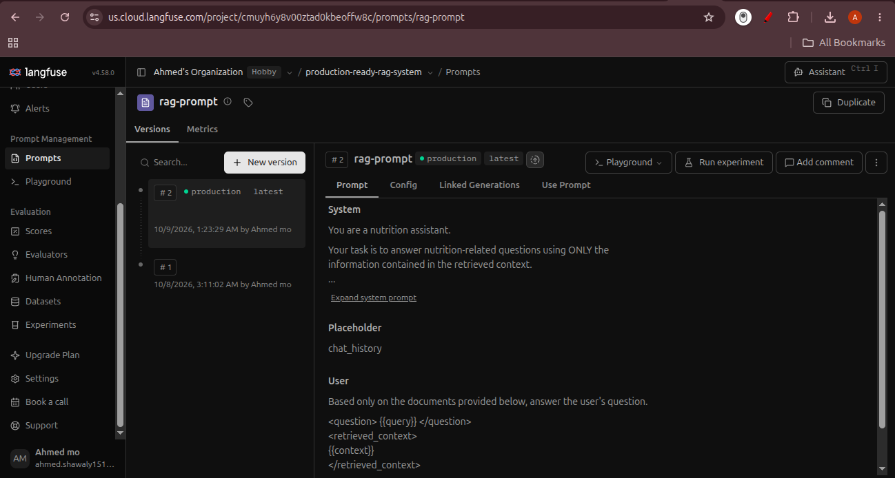

The user message uses these variables. The API fills them in when it answers:

| Variable | Content |
|---|---|
| `{{query}}` | The user's question (after guardrail masking) |
| `{{context}}` | The retrieved document chunks, numbered with their source and page |

> **The variable names in the prompt will be exactly the names the code passes when compiling the prompt** . If they differ, Langfuse leaves the placeholder as plain text, and the model never sees the question. In a trace you will see a literal `{{query}}` in the generation input.

The API loads the version labeled `production` when it starts. If the prompt does not exist or has no `production` label, the API will not start. After you promote a new version, restart the API to pick it up:

```bash
docker compose restart fastapi
```

### 3. Check that tracing works

Send a question, then open **Tracing** in the Langfuse project:

```bash
curl -N -X POST http://localhost/api/v1/chat \
  -H "Content-Type: application/json" \
  -d '{"question": "Which foods are rich in vitamin C?"}'
```

You should see a `rag-chat` trace with these steps: `question-embedding`, `semantic-cache-lookup`, `vector-retrieval`, `prompt-compilation`, `rag-generation` and `semantic-cache-write`. The generation step shows the model, the prompt name and version, token usage and latency.

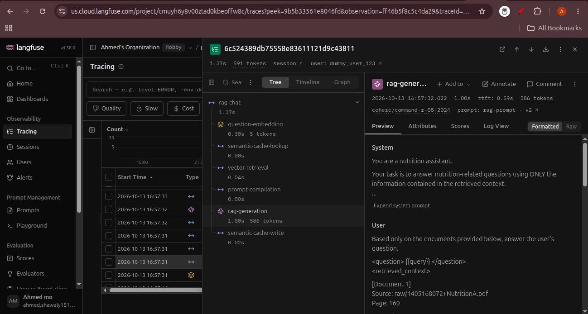

Ask the same question again. The answer now comes from the semantic cache: the trace has only `question-embedding` and `semantic-cache-lookup`, and the output shows `cached: true`. There is no retrieval and no generation, so it is faster and costs no generation tokens.

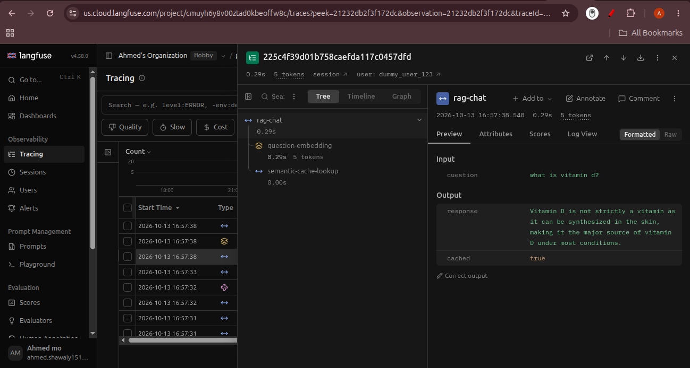

The same project holds your experiment runs and evaluation scores, so traces, prompt versions and results stay linked.

## Ingesting documents (MinIO + Prefect)

Documents go into MinIO. A Prefect flow reads them, parses, chunks, embeds, and writes the vectors to Qdrant.

### 1. Create the bucket and upload files

Open the MinIO console at http://localhost:9001 and sign in with the credentials from your MinIO env file.

1. **Create Bucket** with the name from `bucket_name` in the pipeline settings default `rag-data` or any name.
2. Create the folder/path `raw/` and upload your files into it (PDFs, TXTs are supported and later we will enable more).

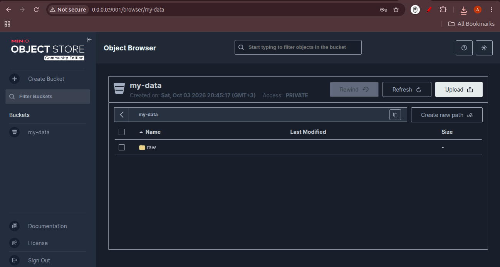

After the first ingestion run, the bucket has three folders:

| Folder | Content |
|---|---|
| `unprocessed/` | Unsupported files extension. |
| `processed/` | Files that finished ingestion successfully (moved here by the flow). |
| `extracted/` | Text extracted from each file. The reindex flow reads from here. |

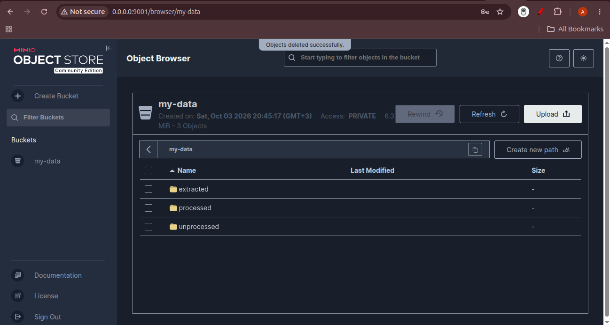

### 2. Run the ingestion flow in Prefect

Open the Prefect UI at http://localhost:4200 and go to **Deployments**. You should see two deployments with status **Ready**: `rag-data-ingestion` and `reindex-pipeline`. They are registered by `data_pipeline/deploy.py`.

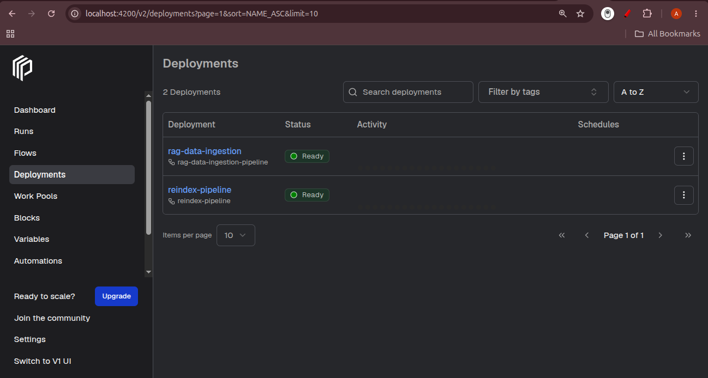

1. Open `rag-data-ingestion` and click **Run**. The flow runs on the work pool `default-agent-pool`.

   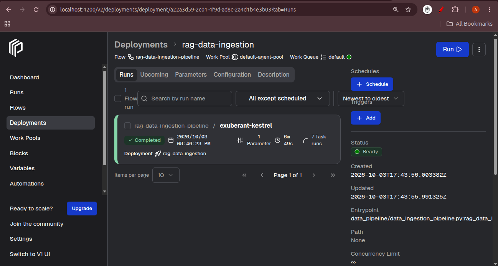

2. Check the parameters, then run.

   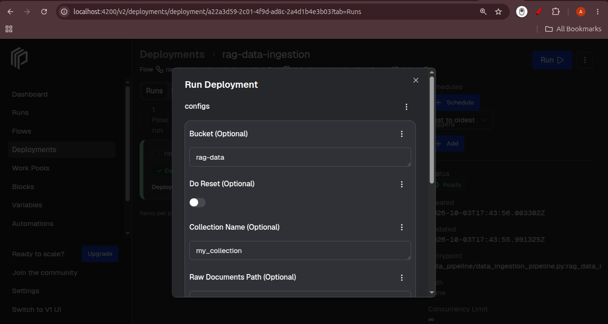

   | Parameter | Meaning |
   |---|---|
   | Bucket | Defaults to `bucket_name`. Must be the bucket you created in MinIO. |
   | Collection Name | Defaults to `default_collection_name`. **Must equal `USED_COLLECTION_NAME` in `.env.app`.** |
   | Raw Documents Path | The folder in the bucket that holds the new files. |
   | Do Reset | Turn on to delete and rebuild the collection before indexing. Leave off to add to it. |

3. Watch the run. The graph shows the tasks: list files, extract text, chunk pages, save extracted text, move file, process file, index into the vector database.

   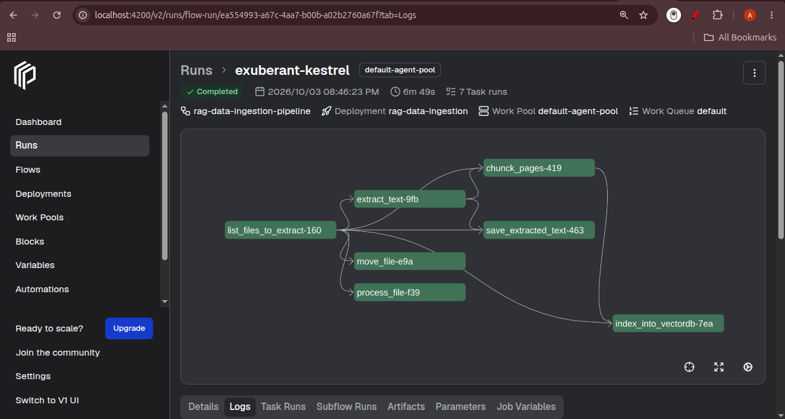

4. Open the **Logs** tab. Warnings like "Skipping empty page" are normal (blank or image-only pages). The log shows pages and chunks per file.

   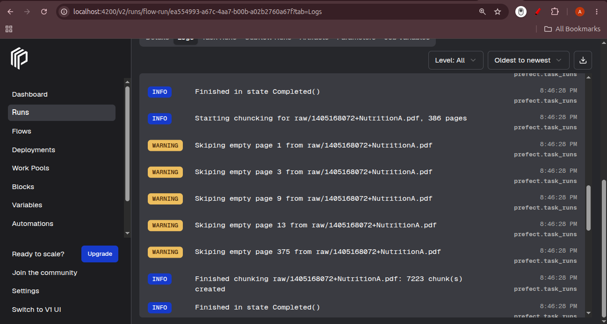

   A finished run ends with a summary of files processed and skipped:

   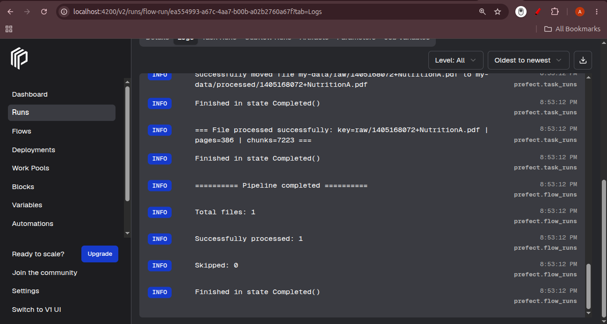


5. Verify the vectors in the Qdrant dashboard at http://localhost:6333/dashboard.

### 3. Reindex (change chunking or embedding model)

Run the `reindex-pipeline` deployment. It reads the saved text from `extracted/`, so nothing is parsed again. Use it after you change the chunk size, the overlap, or the embedding model. For a new embedding model also follow [Choosing an embedding model](#choosing-an-embedding-model).

## API

| Method | Path | Description |
|---|---|---|
| `GET` | `/api/v1/health` | Health check |
| `POST` | `/api/v1/chat` | Ask a question; streams the answer as SSE |

Request body for `/chat`:

```json
{ "question": "Which foods are rich in vitamin C?" }
```

The stream sends a `documents` event (the sources used), then `token` events with the answer text, then `done`. Errors arrive as an `error` event.

## Local development

```bash
uv sync --all-packages          # installs api, data_pipeline, shared and dev tools
uv run pre-commit install       # enable lint checks on commit
```

To run the API on your machine, start the supporting services (Redis, Qdrant, LiteLLM) with Docker, put your settings in `api/api/.env` (with `localhost` hosts), then:

```bash
uv run uvicorn api.main:app --reload --port 8000
```

## Testing and code quality

```bash
uv run pytest                        # everything
uv run pytest api/tests -v           # API only
uv run pytest shared/tests -v        # shared only
uv run pytest data_pipeline/tests -v # pipeline only
```

The tests use mocks and in-memory fakes for Redis, Qdrant, Langfuse and the LLM, so they run without Docker.

Ruff and the other checks run through pre-commit. To run them manually:

```bash
uv run pre-commit run --all-files
```

## Evaluation, load testing, CI, monitoring

- **Evaluation:** [RAGAS](https://docs.ragas.io) scores retrieval and answer quality against a question set, and Langfuse stores each run so you can compare prompt versions, models and retrieval settings. See [evals/README.md](evals/README.md).
- **Load testing:** [Locust](https://locust.io/) simulates many users on `/api/v1/chat` so you can find the rate the system handles before it degrades. See [loadtests/README.md](loadtests/README.md).
- **CI:** GitHub Actions runs the lint checks and the test suite on every push and pull request.
- **Monitoring:** Prometheus scrapes the API, Qdrant, node-exporter and Postgres. Grafana ships with four recommended dashboards. Setup steps are in [docker/README.md](docker/README.md#monitoring-with-grafana).

## Troubleshooting

| Problem | Likely cause and fix |
|---|---|
| API container exits at startup | Langfuse keys missing or wrong, wrong `LANGFUSE_BASE_URL` region, or the prompt `PROMPT_NAME` has no `production` label. Check `docker compose logs fastapi`. |
| The API says there is not enough information for every question | Qdrant is empty or `USED_COLLECTION_NAME` differs from the collection the pipeline wrote to. Check the Qdrant dashboard. Or `MIN_RETRIEVAL_SCORE` is too high. |
| Rate-limit errors | The `rpm` values in `docker/litellm_proxy/config.yml` are lower than your traffic. |
| Search returns garbage after changing the embedding model | Old vectors are still in use. Follow [Choosing an embedding model](#choosing-an-embedding-model). |
| Ingestion run finds no files | The Bucket or Raw Documents Path parameter does not match where you uploaded the files in MinIO. |

More Docker-specific problems are in [docker/README.md](docker/README.md#troubleshooting).

## Monorepo design

The project is one repository with three packages, split by responsibility:

| Package | Responsibility | Runs as |
|---|---|---|
| `api` | Answers questions in real time | Long-running web service |
| `data_pipeline` | Turns documents into vectors | Scheduled and on-demand batch jobs (Prefect) |
| `shared` | Code both sides need | Library only, never run on its own |

```
        api ───────┐
                   ├──► shared
 data_pipeline ────┘
```

**Why separate the data pipeline from the API?**

- **Different workloads.** The API must answer in seconds and stay up. The pipeline does heavy, slow work like parsing, chunking and embedding, and it can fail and retry without users noticing.
- **Independent deployment and scaling.** Each has its own Docker image. You can redeploy the API without touching ingestion, or scale workers without scaling the API.
- **Smaller dependencies.** The API image does not carry the parsing and orchestration libraries, and the pipeline image does not carry the web stack.
- **Fault isolation.** A crashing ingestion job cannot take down the chat endpoint.

**Why a `shared` package?** The API and the pipeline must agree on how data is written and read. `shared` holds the LLM and embedding clients, the vector DB interface with its Qdrant provider, and the prompt manager. Both sides use the same code, so the embedding model and collection settings used for indexing match what the API uses for search. A mismatch here silently ruins retrieval.

**Why one repository?** A change to `shared` and the code that uses it goes in one commit and one pull request. One `uv.lock` keeps versions consistent. One CI pipeline tests everything together.

**Rules**

1. `api` and `data_pipeline` never import from each other. They only talk through the data in Qdrant and MinIO.
2. `shared` never imports from `api` or `data_pipeline`.
3. Each package declares its own dependencies in its own `pyproject.toml`, and uses `shared = { workspace = true }` to reach the local `shared` package.
